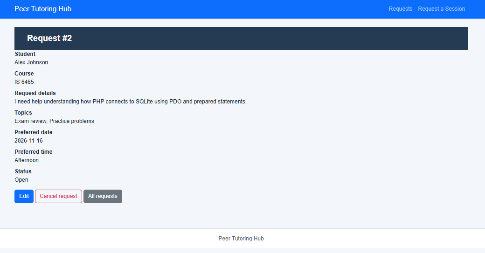

# Lab 6: PHP, PDO, and SQLite Integration

**Course:** IS 6465 – Web Based Applications

## Part 1: Database Setup

I created the SQLite database using the following command from the `lab6` directory:

```bash
sqlite3 database/tutoring.db < database/setup-database.sql
```

I then opened the database using `sqlite3 database/tutoring.db` and executed the `.tables` command to verify that the database was created correctly.

The output confirmed that both required tables exist:

```text
students     tutoring_requests
```

**Result:** PASS – The SQLite database was successfully created, and both required tables were verified.

## Part 2: Run the Application

I started the PHP development server from the `lab6` directory using:

```bash
php -S 0.0.0.0:8000
```

I opened the application in my browser at:

https://potential-broccoli-74g6gj4g7p52rq6r-8000.app.github.dev/php/request-form.php

I submitted a tutoring request using fictional student information for Alex Johnson, selecting IS 6465, Exam review and Practice problems, November 16, 2026, and Afternoon.

The application successfully saved the submission and redirected to the request details page. The confirmation displayed Request #2 with the correct student information, course, topics, preferred date and time, and a status of Open.

**Result:** PASS – The application successfully processed, saved, and displayed the tutoring request.

### Request Confirmation Screenshot



## Part 3: Browser Test Results

| Test | What I Did | Expected Result | Actual Result | Pass or Fail |
|---|---|---|---|---|
| 1. Valid submission | Submitted a tutoring request for Alex Johnson in IS 6465. | A new Open request is created and its details are displayed. | Request #2 was created with the correct student, course, topics, date, time, and Open status. | Pass |
| 2. View all requests | Opened the All Requests page. | All stored tutoring requests appear. | Both Request #1 (Maria Lopez) and Request #2 (Alex Johnson) appeared. | Pass |
| 3. Filter requests | Filtered by IS 6465 and Open, then by IS 6495 and Open before editing Request #2. | Matching records appear; unmatched filters show no results. | Both IS 6465 requests appeared for the first filter. The second filter displayed "No matching requests." | Pass |
| 4. Edit an Open request | Edited Request #2, changing its course to IS 6495, description, and selected topics. | The existing request is updated without changing its ID. | Request #2 displayed the updated information, retained its ID, and remained Open. | Pass |
| 5. Cancel an Open request | Cancelled Request #2 using the cancellation workflow. | Status changes to Cancelled while the record is retained. | Request #2 remained accessible with its information intact and status Cancelled. | Pass |
| 6. Modify a cancelled request | Attempted to access the edit and cancellation pages for Request #2 directly using their URLs. | Editing and repeated cancellation are blocked. | The edit page displayed "Only Open requests may be edited." The cancellation page displayed "Only Open requests can be cancelled" and offered only a Keep request link. | Pass |

## Part 4: Application Workflow

### Workflow Questions

**1. Which file displays the tutoring request form?**

`php/request-form.php` displays the form where students enter their name, email, course, tutoring needs, preferred date, topics, and preferred time.

**2. Which file receives the submitted form data?**

`php/process-request.php` receives the form data through an HTTP POST request. It checks the request method and form identifier before passing the information to the service layer.

**3. Which file creates the PDO database connection?**

`config/db.php` creates the PDO connection to `database/tutoring.db`. It also configures error handling, associative-array results, and SQLite foreign-key enforcement.

**4. Which file coordinates validation and database transactions?**

`services/requestService.php` validates submitted information and coordinates student lookup and request creation. It uses a database transaction so related operations can be committed together or rolled back if an error occurs.

**5. Which files contain the repository SQL statements?**

`repositories/studentPDO.php` contains SQL for finding and inserting students. `repositories/requestPDO.php` contains SQL for creating, retrieving, filtering, updating, and cancelling tutoring requests.

**6. What information is stored in the students table?**

The `students` table stores each student's unique ID, name, and email address. The email field has a UNIQUE constraint to prevent duplicate email addresses.

**7. What information is stored in the tutoring_requests table?**

The `tutoring_requests` table stores each request's ID, associated student ID, course, topic information, preferred date and time, status, and creation timestamp.

**8. How is a tutoring request connected to a student?**

The `student_id` column in `tutoring_requests` is a foreign key referencing `students.student_id`. This creates a one-to-many relationship, allowing one student to submit multiple tutoring requests.

### Why SQL Belongs in the Repository Layer

Keeping SQL statements in the repository files separates database operations from the form pages and application logic. The PHP pages handle user interactions, while the service layer manages validation and the submission workflow. The repositories handle database queries using PDO and prepared statements. This organization makes the application easier to maintain, troubleshoot, and update without spreading SQL throughout multiple PHP files.

## Part 5: Integration Tests

I ran the provided integration test script from the `lab6` directory using:

```bash
php tests/integration-tests.php
```

The initial run passed 11 of 14 checks, with three failures caused by the sample records loaded from `setup-database.sql`. The tests expected empty tables, but the setup script inserted an existing student and tutoring request.

To resolve this, I added two statements to `tests/integration-tests.php` after the database setup and before the test cases:

```php
$pdo->exec('DELETE FROM tutoring_requests');
$pdo->exec('DELETE FROM students');
```

These statements clear the sample records from the temporary in-memory test database without affecting the application's actual SQLite database.

After rerunning the tests, all 14 checks passed. The tests verified request creation, duplicate-student handling, filtering, validation, editing, cancellation, foreign-key enforcement, and database integrity.

**Original Test Suite Result: PASS — All 14 integration checks passed.**

**Final Test Suite Result: PASS — All 15 integration checks passed after adding the AI-recommended test in Part 6.**

### Complete Integration Test Output

After adding the AI-generated test in Part 6, I reran the complete integration test suite. The final output was:

```text
PASS UC01 create and Open
PASS Lab 4 checkbox values preserved
PASS Duplicate email reuses student
PASS UC02 course and status filter
PASS Invalid reason rejected
PASS Invalid submission writes nothing
PASS Edit Open request
PASS Updated reason persisted
PASS Cancel Open request
PASS Cancelled row retained
PASS Second cancellation rejected
PASS Cancelled request cannot be edited
PASS Unrelated request unchanged
PASS FK enforced
PASS UC02 empty filter result
All integration checks passed
```

The terminal also displayed an Xdebug debugging-client connection warning before the test results. This did not prevent the integration tests from running successfully. All 15 checks passed.

## Part 6: AI Skills Pack

The three activities below document the AI prompts I originally used, the responses, my evaluations, and the additional test I actually executed. These activities were completed before I received the instructor’s downloadable Skill instruction files. I subsequently compared the completed work with those files; that retrospective comparison is documented below. The appendix contains expanded, reformatted reconstructions of the original AI responses, not verbatim chat transcripts.

### Activity 1: Application Builder

**Prompt:**

Explain how a tutoring request moves from php/request-form.php through PHP, PDO, and SQLite in this project. Identify the responsibility of each file.

**AI Response (Summary):**

The AI explained that `php/request-form.php` collects student information and submits it to `php/process-request.php` using POST. The handler calls `openDatabase()` from `config/db.php` to establish a PDO connection and passes the submitted data to `submitRequest()` in `services/requestService.php`.

The service validates the information and coordinates a database transaction. It uses `repositories/studentPDO.php` to find or create the student and `repositories/requestPDO.php` to insert the tutoring request. The data is stored in `database/tutoring.db`, using the tables defined in `database/setup-database.sql`. After a successful submission, the application redirects to the new request's details page.

**Evaluation Against the Actual Code:**

I verified the AI's statement that the service layer manages the database transaction and coordinates student lookup and request creation. In `services/requestService.php`, the `submitRequest()` function calls `beginTransaction()`, `insertStudentIfAbsent()`, `findStudentByEmail()`, `insertTutoringRequest()`, and `commit()`. This confirms that the AI accurately described the service layer's responsibilities. The explanation also helped me understand why the application separates the form, service, and repository layers.

### Activity 2: Traceability Auditor

**Prompt:**

Act as a Traceability Auditor for my IS 6465 Peer Tutoring Hub Lab 6 application. Create a traceability table showing how the requirements for creating, listing/filtering, editing, and cancelling tutoring requests are implemented. Use these columns: Requirement | Application Page | Service or Validation | Repository or SQL | Database Table | Test Evidence. Base your analysis on the PHP, PDO, SQLite, and integration test files we previously reviewed. Identify any gaps or limitations rather than assuming functionality exists.

**AI Response (Summary):**

The AI traced the four primary requirements through the application layers and identified supporting integration tests.

| Requirement | Application Page | Service or Validation | Repository or SQL | Database Table | Test Evidence |
|---|---|---|---|---|---|
| Student submits a tutoring request | `request-form.php`, `process-request.php` | `submitRequest()`, `validateSubmission()` | `insertStudentIfAbsent()`, `insertTutoringRequest()` | `students`, `tutoring_requests` | UC01 create and Open; duplicate email |
| List/filter requests | Request listing page | Filter parameters | `listRequests()` | `students`, `tutoring_requests` | UC02 course and status filter; empty filter result |
| Edit request | Request editing page | `reviseRequest()` | `updateOpenRequest()` | `tutoring_requests` | Edit Open request; updated reason persisted |
| Cancel request | Request cancellation action | Open-status restriction | `cancelOpenRequest()` | `tutoring_requests` | Cancel Open request; cancelled row retained; second cancellation rejected |

The AI identified limitations in the available evidence, including unconfirmed filenames for some application pages and incomplete coverage of invalid input scenarios.

**Evaluation Against the Actual Code:**

I verified the AI's explanation of request cancellation against `repositories/requestPDO.php`. The `cancelOpenRequest()` function uses a status-restricted update so only Open requests can be cancelled. The integration tests also confirmed that a cancelled record remains in the database and cannot be cancelled a second time.

I agree with the AI's observation that passing all 14 integration tests does not guarantee every possible input has been tested. The traceability table helped me connect each application requirement to the code responsible for implementing it and the tests that verify its behavior.

#### Supplementary Traceability Status Review

The original six-column matrix above is retained to match the Lab 6 assignment. The instructor's downloadable auditor also distinguishes implementation evidence from executed verification. The following statuses refer only to the specific behaviors tested and documented in Parts 3 and 5; they are not a complete audit of every acceptance criterion.

| Requirement area | Executed evidence | Status for documented behavior | Limitation |
|---|---|---|---|
| UC01 — Submit request | Browser test 1; `PASS UC01 create and Open`; duplicate-email and invalid-submission checks | Verified for tested cases | Not every possible invalid input was tested |
| UC02 — View and filter | Browser tests 2–3; course/status filter and empty-result checks | Verified for tested cases | Full combinations and boundary cases not exhaustively checked |
| UC01 — Edit Open request | Browser test 4; `PASS Edit Open request`; `PASS Updated reason persisted` | Verified for tested cases | Not all invalid edits or field combinations checked |
| UC01 — Cancel Open request | Browser tests 5–6; cancellation, retained-row, second-cancellation, and cancelled-edit checks | Verified for tested cases | The added cancelled-edit test checks rejection, not a fresh post-attempt database read |

The original materials available for this review do not establish formal requirement IDs for every individual acceptance criterion, so no additional IDs are invented here.

---

### Activity 3: Test Harness Generator

**Prompt:**

Act as a Test Harness Generator for my IS 6465 Peer Tutoring Hub Lab 6 application. Review the 14 passing integration tests in tests/integration-tests.php that we previously examined. Identify one meaningful behavior that the existing tests do not explicitly cover. Propose an additional PHP integration test using the application's existing PDO and SQLite functions. Explain what the test checks, why it matters, and what result should be expected. Do not assume the new test passes without executing it.

**AI Response (Summary):**

The AI identified that the existing integration tests verified that cancelled requests could not be cancelled again, but did not explicitly verify that cancelled requests could not be edited. It recommended adding a test that attempts to edit a cancelled request using the existing `reviseRequest()` function.

The AI proposed the following PHP test:

```php
$editCancelled = $sample;
$editCancelled['reason'] = 'Attempt to edit a cancelled request.';
check(
!reviseRequest($pdo, $id, $editCancelled),
'Cancelled request cannot be edited'
);
```

**Implementation and Test Results:**

I added the proposed test to `tests/integration-tests.php` immediately after the existing cancellation checks. I then ran the integration test suite using `php tests/integration-tests.php`.

The new test returned:

```text
PASS Cancelled request cannot be edited
All integration checks passed
```

The complete test suite now passes all 15 integration checks.

**Evaluation Against the Actual Code:**

The AI correctly identified a missing test scenario. The new test uses the existing `reviseRequest()` service function and verifies that an edit attempt on a cancelled request is rejected. This is consistent with the Open-status restriction in `updateOpenRequest()` within `repositories/requestPDO.php`.

I verified the AI's recommendation by adding and executing the test rather than assuming it would pass. Although the test confirms that the edit operation is rejected, an additional check of the stored record would provide stronger evidence that its contents remain unchanged.

### AI Skills Pack Reflection

Using AI during this lab helped me better understand how the different parts of the application work together. The Application Builder explained how information moves from the PHP form through the service and repository layers into SQLite, while the Traceability Auditor helped connect application requirements to the code and tests that support them. The Test Harness Generator was especially useful because it identified a missing test scenario that I was able to implement and verify, increasing the number of passing integration tests from 14 to 15. I also learned that AI-generated explanations and code should be checked against the actual application rather than assumed to be correct. Overall, these activities showed me how AI can help with understanding, testing, and improving an application while still requiring my own verification.

### Follow-up Review Against the Instructor-Provided Skills

After completing the original three AI activities, I reviewed the instructor's `application-builder.txt`, `traceability-auditor.txt`, and `test-harness-generator.txt` instructions. The comparison below describes alignment with the Skill Pack; it is a **retrospective documentation review**, not a claim that the supplied Skills were used during the original prompts or that additional tests were executed.

| Instructor Skill | Existing Lab 6 evidence | Alignment and remaining limitation |
|---|---|---|
| Application Builder | Activity 1 explains the form → handler → service → repository → SQLite workflow, and Part 4 identifies the responsible files. | Supports the Skill's architecture and explanation goals. Activity 1 explained existing code; it did not generate a new feature or a complete changed-file implementation. |
| Requirements Traceability Auditor | Activity 2 maps request creation, listing/filtering, editing, and cancellation to application layers and test evidence. | Covers the original Lab 6 six-column traceability requirement. The downloadable Skill also requests requirement IDs, explicit verification statuses, backward traceability, and prioritized findings; those were not all established by the original audit. |
| Test Harness Generator | Activity 3 proposed a test rejecting edits to cancelled requests; I added it and ran the complete suite, with all 15 checks passing. | Demonstrates an executed, meaningful regression check. The downloadable Skill describes broader test matrices and additional boundary cases; the 15 checks should not be interpreted as exhaustive coverage. |

**Verification status based on the evidence recorded in this lab:** The four primary workflows have executed browser-test evidence and relevant integration-test evidence. The new cancelled-edit restriction has a passing service-level integration check. These results support the tested behaviors, but do not prove that every input, security control, or edge case has been verified.

**Known limitations and follow-up opportunities:** The original traceability audit did not establish every page filename or every acceptance-criterion ID. More thorough testing could include malformed email, invalid dates, combined-filter edge cases, and a database-state assertion after a rejected edit. Authentication, authorization, CSRF protection, and the separate User Management CRUD design are outside the completed Lab 6 scope; they should not be represented as implemented functionality. No application code, database schema, or test results were changed as part of this retrospective review.

## Part 7: SQL JOIN Query

I executed a SQL JOIN query against the application's SQLite database using the following command:

```bash
sqlite3 -header -column database/tutoring.db "SELECT r.request_id, s.student_name, s.student_email, r.course, r.topic, r.preferred_date, r.preferred_time, r.status FROM tutoring_requests AS r JOIN students AS s ON r.student_id = s.student_id ORDER BY r.request_id;"
```

**Query Results:**

| Request ID | Student Name | Email | Course | Preferred Date | Preferred Time | Status |
|---|---|---|---|---|---|---|
| 1 | Maria Lopez | maria.lopez@example.com | IS 6465 | 2026-11-03 | 14:00 | Open |
| 2 | Alex Johnson | alex.johnson@example.com | IS 6495 | 2026-11-16 | Afternoon | Cancelled |

The query also returned the `topic` field. Maria's record contained a plain-text tutoring topic, while Alex's record contained JSON with his tutoring reason and selected topics.

**Explanation:**

The JOIN connects the `tutoring_requests` and `students` tables by matching `tutoring_requests.student_id` with `students.student_id`. This allows the query to display each student's name and email alongside the corresponding tutoring request information without duplicating student details in the requests table.

The results confirmed that both requests were stored correctly and that Alex Johnson's cancelled request remained in the database with a status of `Cancelled`.

**Result: PASS — The SQL JOIN successfully retrieved the related student and tutoring request records.**

## Appendix: Detailed AI Skills Pack Responses

### Activity 1: Application Builder

#### Prompt

Explain how a tutoring request moves from php/request-form.php through PHP, PDO, and SQLite in this project. Identify the responsibility of each file.

#### AI Response

The Peer Tutoring Hub uses a layered architecture to process tutoring requests. Each layer has a specific responsibility, from collecting information in the browser to storing it in SQLite.

**1. `php/request-form.php` — Collects information**

This file displays the HTML form where students enter their name, email, course, tutoring needs, preferred date, topics, and preferred time. When the student submits the form, the information is sent to `process-request.php` using the HTTP POST method.

**2. `php/process-request.php` — Handles the submission**

This file receives the submitted information through `$_POST`. It verifies that the request uses POST and contains the expected form identifier. It calls `submitRequest(openDatabase(), $_POST)` and redirects the browser to the newly created request's details page after a successful submission.

**3. `config/db.php` — Establishes the database connection**

The `openDatabase()` function uses PDO (PHP Data Objects) to connect to `database/tutoring.db`. It configures database error handling, associative-array results, and SQLite foreign-key enforcement.

**4. `services/requestService.php` — Validates and coordinates operations**

The `submitRequest()` function calls `validateSubmission()` to check the submitted information. Once validation succeeds, the service starts a database transaction, ensures the student exists, retrieves the student's ID, and creates the tutoring request. If an operation fails, the transaction is rolled back.

**5. `repositories/studentPDO.php` — Handles student records**

This repository contains SQL statements for student-related operations. `insertStudentIfAbsent()` attempts to add a student without duplicating an existing email, while `findStudentByEmail()` retrieves the student's record and student ID.

**6. `repositories/requestPDO.php` — Handles tutoring requests**

This repository contains SQL statements to insert, retrieve, filter, update, and cancel tutoring requests. During a new submission, `insertTutoringRequest()` executes a parameterized SQL INSERT statement and returns the new request ID. Prepared statements help prevent SQL injection.

**7. `database/setup-database.sql` — Defines the database structure**

This file defines the `students` and `tutoring_requests` tables, including their primary keys, constraints, and foreign-key relationship. The `tutoring_requests.student_id` column references `students.student_id`.

**8. `database/tutoring.db` — Stores the information**

The SQLite database file stores student and tutoring-request records. Once the transaction commits, the new request is saved and can be retrieved for display.

#### Example

When Alex Johnson submitted his tutoring request, the form collected his information and sent it to `process-request.php`. The service validated the submission and used the PDO repositories to find or create his student record and insert the tutoring request. SQLite saved the request, and the application redirected to Request #2, displaying its information with an initial status of Open.

#### Why the architecture matters

Separating the application into layers makes the code easier to maintain, test, and troubleshoot. The form handles user input, the service manages business rules and transactions, and the repositories handle SQL operations. Validation, prepared statements, foreign-key constraints, and transactions support data integrity and security.

**---**

### Activity 2: Traceability Auditor

#### Prompt

Act as a Traceability Auditor for my IS 6465 Peer Tutoring Hub Lab 6 application. Create a traceability table showing how the requirements for creating, listing/filtering, editing, and cancelling tutoring requests are implemented. Use these columns: Requirement | Application Page | Service or Validation | Repository or SQL | Database Table | Test Evidence. Base your analysis on the PHP, PDO, SQLite, and integration test files we previously reviewed. Identify any gaps or limitations rather than assuming functionality exists.

#### AI Response

The Peer Tutoring Hub implements four primary request-management requirements. The following traceability matrix connects each requirement to its implementation and supporting test evidence.

| Requirement | Application Page | Service or Validation | Repository or SQL | Database Table | Test Evidence |
|---|---|---|---|---|---|
| Student submits a tutoring request | `request-form.php`, `process-request.php` | `submitRequest()`, `validateSubmission()` | `insertStudentIfAbsent()`, `insertTutoringRequest()` | `students`, `tutoring_requests` | UC01 create and Open; duplicate email; invalid reason |
| List and filter requests | Request listing page | Filter parameters | `listRequests()` | `students`, `tutoring_requests` | UC02 course and status filter; empty filter result |
| Edit an Open request | Request editing page | `reviseRequest()` | `updateOpenRequest()` | `tutoring_requests` | Edit Open request; updated reason persisted |
| Cancel an Open request | Request cancellation action | Open-status restriction | `cancelOpenRequest()` | `tutoring_requests` | Cancel Open request; cancelled row retained; second cancellation rejected |

**The exact filenames for the listing, editing, and cancellation pages were not confirmed in the code excerpts used for the original AI audit.**

#### Verification of Requirements

**Create a tutoring request:** The `submitRequest()` function validates submitted information, starts a database transaction, finds or creates the student, and inserts the tutoring request. Integration tests verify Open status, duplicate-student handling, and invalid-reason rejection.

**List and filter requests:** The `listRequests()` function retrieves tutoring requests using optional course and status filters. Integration tests confirm matching results and an empty result when no records match.

**Edit an Open request:** The `reviseRequest()` service coordinates updates, while `updateOpenRequest()` restricts changes to requests with Open status. Tests confirm that edits succeed and updated information is persisted.

**Cancel an Open request:** The `cancelOpenRequest()` function changes the status to Cancelled without deleting the record. Tests verify successful cancellation, record retention, and rejection of a second cancellation.

#### Gaps and Limitations Identified

1. The original audit did not verify exact filenames for all request-management pages.

2. The integration tests did not cover every possible invalid input, such as malformed emails or invalid dates.

3. The tests did not establish authentication or authorization controls.

4. Integration tests used an in-memory SQLite database, so browser testing was also needed to verify behavior with the persistent database.

#### Overall Assessment

All four primary requirements have supporting implementation and test evidence. The application's separation of presentation, service, and repository responsibilities supports maintainability. PDO prepared statements, validation, transactions, foreign-key constraints, and status-restricted updates support reliable database operations.

The original 14 passing integration tests provided evidence that the primary workflows worked, but did not establish exhaustive test coverage or confirm every possible security requirement.

**---**

### Activity 3: Test Harness Generator

#### Prompt

Act as a Test Harness Generator for my IS 6465 Peer Tutoring Hub Lab 6 application. Review the 14 passing integration tests in tests/integration-tests.php that we previously examined. Identify one meaningful behavior that the existing tests do not explicitly cover. Propose an additional PHP integration test using the application's existing PDO and SQLite functions. Explain what the test checks, why it matters, and what result should be expected. Do not assume the new test passes without executing it.

#### AI Response

The existing 14 integration tests covered request creation, duplicate-student handling, filtering, validation, editing, cancellation, foreign-key enforcement, and database integrity.

However, the tests did not explicitly verify whether a cancelled tutoring request could be edited afterward. Although the existing suite confirmed that a cancelled request could not be cancelled again, it did not directly test whether an edit attempt would be rejected.

#### Proposed Additional Integration Test

The AI recommended adding this test to `tests/integration-tests.php` after the existing cancellation checks:

```php
$editCancelled = $sample;
$editCancelled['reason'] = 'Attempt to edit a cancelled request.';
check(
!reviseRequest($pdo, $id, $editCancelled),
'Cancelled request cannot be edited'
);
```

#### What the Test Checks

The test attempts to edit a tutoring request that has already been cancelled. It uses the existing `reviseRequest()` service function and checks whether the operation returns `false`, indicating that the update was rejected.

#### Why the Test Matters

Cancelled requests should remain unchanged to preserve accurate historical records. The `updateOpenRequest()` function in `repositories/requestPDO.php` restricts updates to requests with an Open status. This test provides additional evidence that the restriction is enforced through the application's service and repository layers.

#### Expected Result

If the application behaves as intended, the new test should report:

```text
PASS Cancelled request cannot be edited
```

The AI did not claim that the test had passed before execution.

#### AI Evaluation

The proposed test addressed a meaningful gap in the original integration test suite. It reused existing application functions, required no database schema changes, and operated on the temporary in-memory SQLite database.

The AI also identified one possible improvement: checking the stored record after the rejected edit to confirm that its original contents remained unchanged.

#### Actual Implementation and Verification

After receiving the AI recommendation, I added the test to `tests/integration-tests.php` and executed the full integration test suite.

The new test returned:

```text
PASS Cancelled request cannot be edited
All integration checks passed
```

All 15 integration checks passed. The actual execution results confirmed that the AI-generated test was appropriate for this application.
