# Lab 7 Notes

## Part 1 — AI-assisted application generation

**Prompt:** Generate code for all user management use cases UM-01 through UM-10 in the User Management Design Document. Use the Application Builder, Test Harness Generator, and Traceability Auditor documents as implementation guidance. Follow the authentication, authorization, session management, password hashing, CSRF protection, and role based access practices in the Authentication Reading Handout. Use lab6.zip as the existing Peer Tutoring Hub application to extend. Preserve the Lab 6 three tier architecture and update the application as needed to support user registration, login, logout, profile management, administrator access, and protected tutoring request workflows. Return a complete Lab 7 application package with all updated and new files.

**Source materials:** Peer Tutoring Hub User Management Design Document; Application Builder, Test Harness Generator and Traceability Auditor (skills pack.zip); IS6465 Authentication Reading Handout v1.2; lab6.zip.

The generated package extends the Lab 6 presentation, application and data tiers with user pages, shared session protection, user services, prepared account queries and a database migration. See README.md for design decisions and traceability. Permanent deletion is blocked because the retention policy is unresolved.


### Verified Code Example — Role-Based Access Control

I reviewed `includes/auth.php` and `php/request-form.php` to verify how the generated application implements authentication and authorization.

The `requireRole()` function in `includes/auth.php` checks whether the authenticated user's role is included in the permitted roles. If the role is not authorized, the function returns an HTTP 403 response and stops execution.

I verified that `request-form.php` calls the following functions before displaying any HTML:

```php
$user = requireLogin($pdo);
requireRole($user, ['Student']);
```

This ensures that only authenticated users with the Student role can access the tutoring request form. These checks are performed on the server rather than relying on hidden navigation links or client-side restrictions. This demonstrates the difference between authentication, which verifies a user's identity, and authorization, which determines what the user is permitted to access.

Verification method: Manual inspection of both generated PHP files in GitHub. Runtime testing will be conducted in later parts of the lab.

## Part 2 — Database Setup

The database was initialized using the following commands:

```powershell
sqlite3 tutoring.db ".read setup-database.sql"
sqlite3 tutoring.db ".read upgrade-to-user-management.sql"
```

Both scripts executed successfully without errors.

The database structure was verified using:

```powershell
sqlite3 tutoring.db ".tables"
```

Output:

```text
students     tutoring_requests     users
```

All three required tables were successfully created. The initial
setup script established the tutoring database, and the upgrade
script extended it to support user management and authentication.

Environment note: This lab was completed using a local Visual
Studio Code environment due to GitHub Codespaces usage limitations.
The SQLite `.read` command was used as the Windows PowerShell
equivalent of the Bash input redirection commands provided in
the lab instructions.

### Database Setup Screenshot Evidence

**Database setup and upgrade: all three required tables listed**

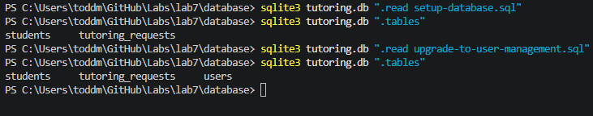

## Part 3 — Create an Administrator Account

An administrator account was created using the create-admin.php
script from the lab7/database directory.

Command structure:

```powershell
php create-admin.php "Test Administrator" admin@example.com "<password>"
```

The actual test password has been omitted from this documentation.

Terminal output:

```text
Created admin@example.com — Administrator
```

The administrator account was independently verified using the
following SQL query:

```sql
SELECT user_id, full_name, email, role, status FROM users;
```

Database verification results:

| Field | Value |
| --- | --- |
| User ID | 1 |
| Full Name | Test Administrator |
| Email | admin@example.com |
| Role | Administrator |
| Status | Active |

The administrator account was successfully created with the
correct role and active status.

### Additional Verification — Duplicate Email Prevention

A second attempt to create an administrator account using
the same email address returned:

```text
Email already registered.
```

The database query confirmed that only one account existed.
This demonstrates that the application prevents duplicate
accounts from being created using the same email address.

## Part 4 — Run the Application

The PHP development server was started from the lab7 root
directory using the following command:

```powershell
php -S 127.0.0.1:8000 php/router.php
```

The server started successfully using PHP 8.4.27.

Application URL:
http://127.0.0.1:8000

### Authentication Protection Verification

Using an Incognito browser window, I attempted to access
the following protected page without logging in:

http://127.0.0.1:8000/php/request-form.php

The application automatically redirected me to:

http://127.0.0.1:8000/php/login.php

The login page displayed successfully, and the protected
tutoring request form was not accessible without authentication.

Result: PASS

This runtime test confirms that the application enforces
authentication before allowing access to the protected
tutoring request form.

### Environment and Security Adjustments

The server was bound to 127.0.0.1 instead of 0.0.0.0 because
the application is running locally rather than in GitHub
Codespaces. The generated php/router.php file was included
in the server command to restrict direct browser access
to sensitive application files.

## Part 5 — Test the Student Workflow

A fictional student account was registered and used to test
the authenticated student workflow.

### Test Account

- Name: Jordan Smith
- Email: jordan.smith@example.com
- Role: Student
- Status: Active

The test password has been omitted from this documentation.

### Student Workflow Testing Results

| Test | What I Did | Expected Result | Actual Result | Pass or Fail |
| --- | --- | --- | --- | --- |
| Public registration roles | Inspected the account type dropdown. | Only Student and Tutor should be available. | Student and Tutor were available. Administrator was not an option. | Pass |
| Student registration | Completed and submitted the registration form. | Account is created and the user is redirected to the login page. | Redirected to the login page with an account creation confirmation message. | Pass |
| Student login | Entered the registered student credentials. | Successful authentication and access to protected pages. | Successfully logged in and redirected to My Profile. | Pass |
| View profile | Reviewed the My Profile page. | Correct name, email, role, and status are displayed. | Jordan Smith's information was displayed with the Student role and Active status. | Pass |
| Student navigation | Inspected the navigation after logging in. | Student functionality is available without administrator management links. | My Profile, Requests, Request a Session, and Log out were displayed. | Pass |
| Student identity fields | Opened the tutoring request form and attempted to modify the name and email. | Identity fields are automatically populated and read-only. | Both fields displayed the authenticated student's information and could not be edited through the form. | Pass |
| Create tutoring request | Submitted a request for IS 6465 with a future date, preferred time, and tutoring topics. | A new request is created with an Open status. | Request #2 was created successfully with the correct information and Open status. | Pass |
| View tutoring requests | Opened the request list with all courses and statuses selected. | The student's own request is displayed without other students' requests. | Only Jordan Smith's Request #2 was displayed. | Pass |
| Edit tutoring request | Changed the preferred date, preferred time, and selected topics. | Existing request is updated without changing its ID, owner, or status. | All changes were saved, and Request #2 remained associated with Jordan Smith with an Open status. | Pass |
| Student logout | Clicked Log out. | The authenticated session ends and the login page is displayed. | Successfully redirected to the login page. | Pass |
| Post-logout access protection | Attempted to directly access the previously viewed request details URL. | Access is denied and the user is redirected to login. | Redirected to the login page without displaying the protected request. | Pass |

### Tutoring Request Verification

| Field | Original Value | Updated Value |
| --- | --- | --- |
| Request ID | 2 | 2 |
| Student | Jordan Smith | Jordan Smith |
| Course | IS 6465 | IS 6465 |
| Topics | Exam review, Practice problems | Exam review, Practice problems, Study plan |
| Preferred Date | 2026-11-25 | 2026-11-27 |
| Preferred Time | Afternoon | Evening |
| Status | Open | Open |

### Testing Summary

All 11 manual student workflow tests passed. The application
successfully supported student registration, login, profile viewing,
tutoring request creation, request viewing, request editing, and
logout.

The post-logout test demonstrated that protected request details
could not be accessed after ending the authenticated session.
The registration interface and student navigation also displayed
appropriate role-based restrictions.

The student's request was intentionally left Open for administrator
testing in Part 6. Student and administrator request visibility
will be compared during that part to further verify authorization.

### Student Workflow Screenshot Evidence

**Successful student registration**

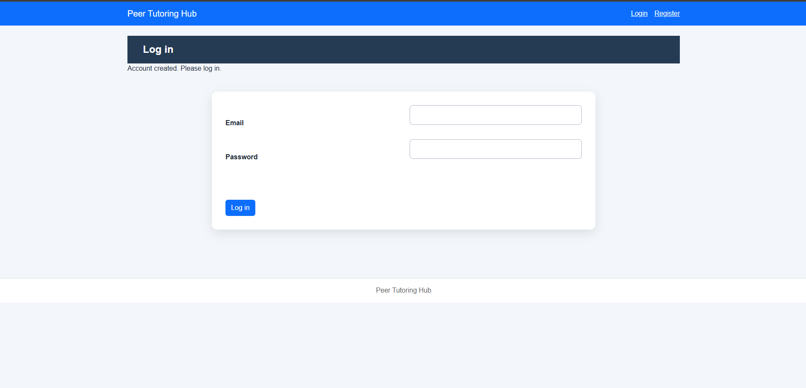

**Authenticated student profile**

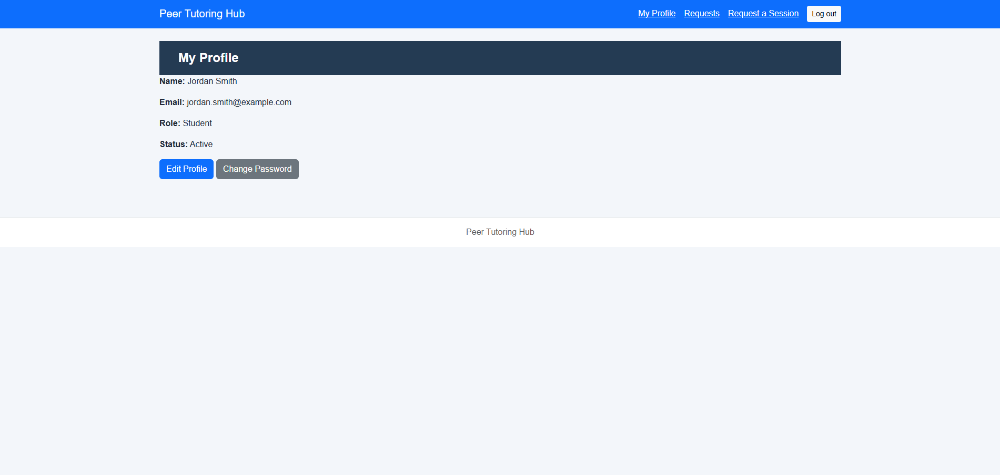

**Original tutoring request**

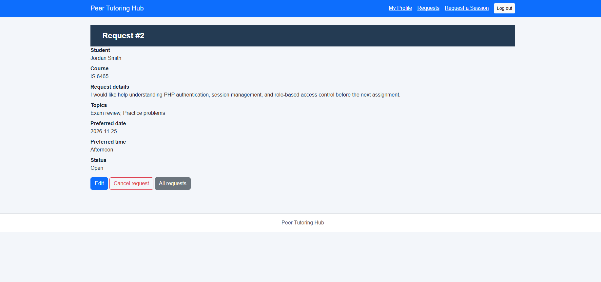

**Student-specific request list**

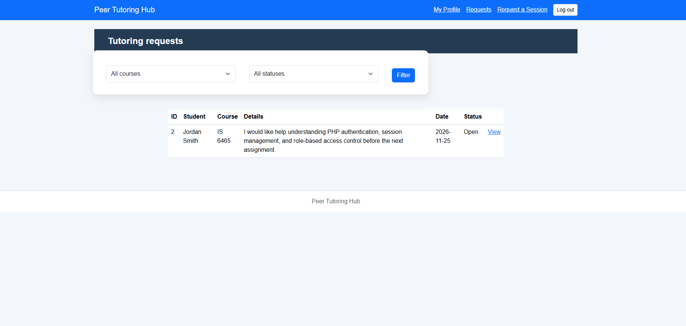

**Updated tutoring request**

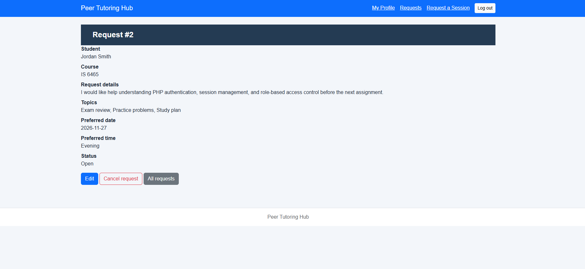

## Part 6 — Test the Administrator Workflow

The fictional administrator account created in Part 3 was
used to test administrator functionality and compare access
permissions with the student account tested in Part 5.

### Test Account

- Name: Test Administrator
- Email: admin@example.com
- Role: Administrator
- Status: Active

The test password has been omitted from this documentation.

### Administrator Workflow Testing Results

| Test | What I Did | Expected Result | Actual Result | Pass or Fail |
| --- | --- | --- | --- | --- |
| Administrator login | Logged in using the administrator credentials. | Successful authentication and access to administrator functionality. | Successfully logged in and redirected to My Profile. | Pass |
| Administrator profile | Reviewed the administrator profile. | Correct account information, Administrator role, and Active status. | All account information was displayed correctly. | Pass |
| Administrator navigation | Inspected the navigation menu. | Manage Users is available and Request a Session is unavailable. | Navigation displayed the appropriate options for the Administrator role. | Pass |
| View registered users | Opened Manage Users. | Both registered accounts are displayed with their roles and statuses. | Jordan Smith and Test Administrator were displayed with correct roles and Active status. | Pass |
| View all tutoring requests | Opened Requests with all courses and statuses selected. | Administrator can view requests belonging to multiple students. | Requests belonging to Jordan Smith and Maria Lopez were displayed. | Pass |
| Administrator access restriction | Directly accessed request-form.php as an administrator. | Access to the student-only request form is denied. | Application displayed "Not authorized." | Pass |
| Administrator logout | Clicked Log out. | Session ends and user returns to the login page. | Successfully redirected to the login page. | Pass |
| Post-logout access protection | Attempted to directly access manage-users.php after logout. | Unauthenticated user is redirected to login. | Redirected to the login page. | Pass |
| Student access restriction | Logged in as Jordan Smith and directly accessed manage-users.php. | Student is denied access to administrator functionality. | Application displayed "Not authorized." | Pass |
| Record-level authorization | While logged in as Jordan Smith, changed the request_id parameter from 2 to 1 in request-details.php. | Student cannot access another student's tutoring request. | Application displayed "Request not found" without revealing Maria Lopez's request information. | Pass |

### Student and Administrator Permission Comparison

| Functionality | Student | Administrator |
| --- | --- | --- |
| View own profile | Allowed | Allowed |
| Access tutoring request creation form | Allowed | Denied |
| View own tutoring requests | Allowed | Allowed as part of all requests |
| View other students' tutoring requests | Denied | Allowed |
| Access user management | Denied | Allowed |
| Log out | Allowed | Allowed |
| Access protected pages after logout | Denied | Denied |

### Tutoring Request Visibility

| Request ID | Student | Student View | Administrator View |
| --- | --- | --- | --- |
| 1 | Maria Lopez | Hidden | Visible |
| 2 | Jordan Smith | Visible | Visible |

The student account displayed only one tutoring request,
while the administrator account displayed both existing
tutoring requests. Both tests were conducted without course
or status filters.

### Authentication vs. Authorization

Authentication determines whether a user is who they claim
to be by verifying their login credentials. Authorization
determines what an authenticated user is permitted to access
based on their role and relationship to specific records.

Both the student and administrator successfully authenticated,
but they were granted different permissions. The administrator
could access user management and all tutoring requests, while
the student could create tutoring requests and access only
their own request records.

Direct URL testing demonstrated that these restrictions were
enforced by the server rather than simply through hidden
navigation links. Testing after logout also demonstrated that
protected pages required an active authenticated session.

### Testing Summary

All 10 documented manual tests passed after verification.
The application successfully demonstrated authentication,
role-based authorization, record-level authorization,
and post-logout access protection.

During record-level authorization testing, the initial URL
used an incorrect parameter name (id instead of request_id).
The application displayed "Invalid request ID." The URL
structure was verified using the student's own request,
and the test was repeated with the correct parameter.
The corrected test successfully prevented unauthorized access.

No application code changes were required during Part 6.
User account roles and statuses were intentionally left
unchanged during testing. Administrative search, filtering,
and account modification functions were not tested in this part.

### Administrator Workflow Screenshot Evidence

**Authenticated administrator profile**

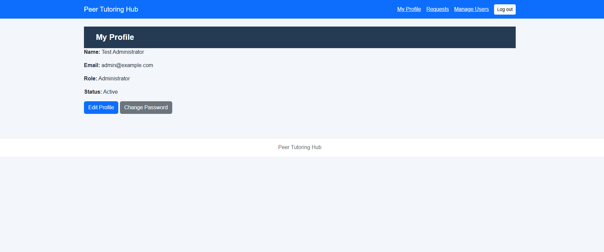

**Administrator user management**

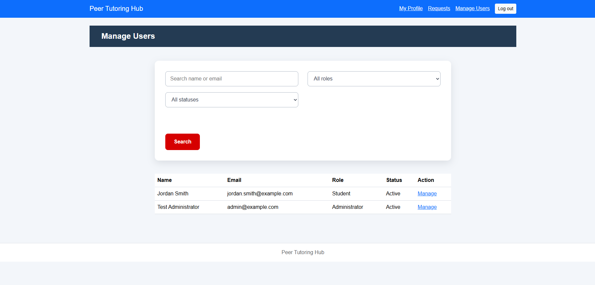

**Administrator access to both tutoring requests**

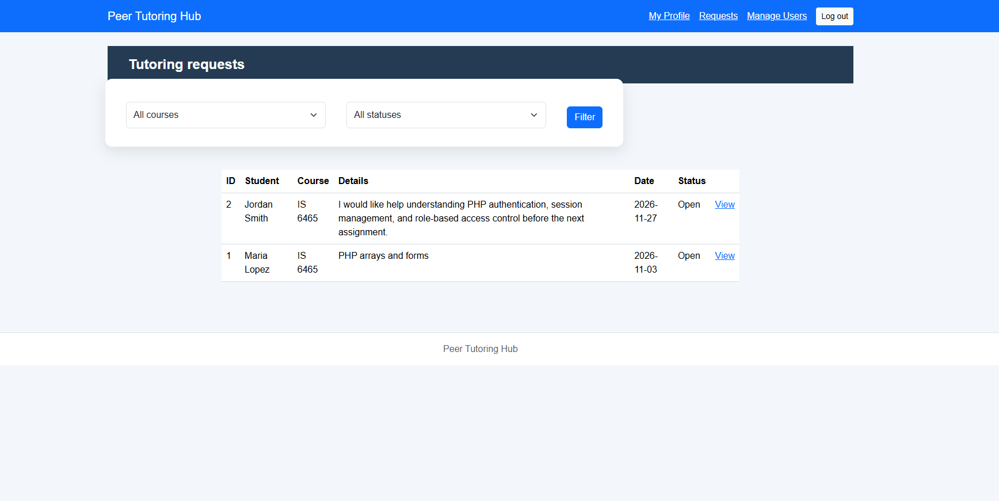

**Administrator denied access to student request form**

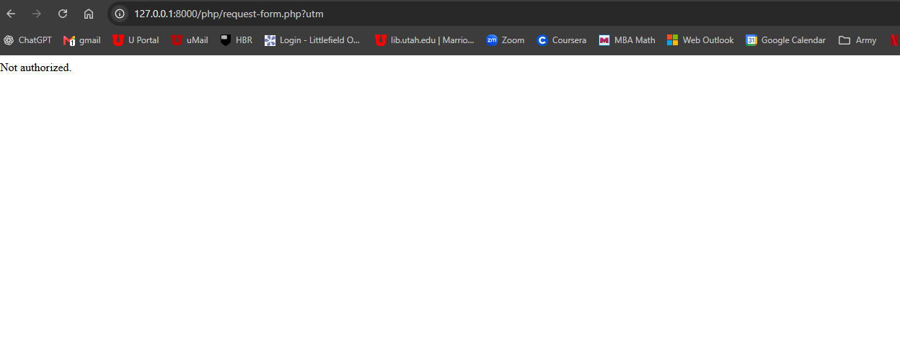

**Student denied access to user management**

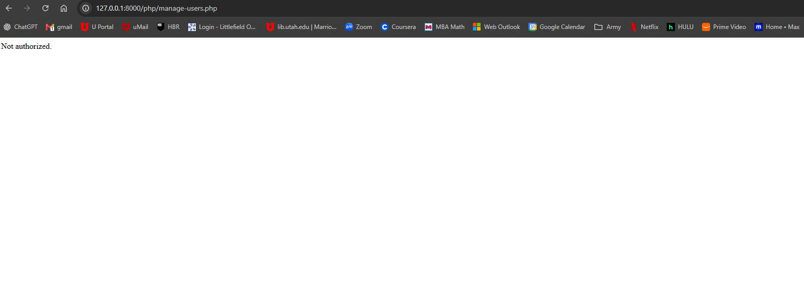

**Student denied access to another student’s request**

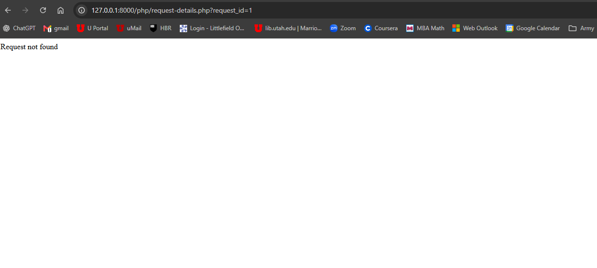

## Part 7 – Examine Registration and Login Workflows

### Registration Workflow

I manually examined `php/register.php`, `services/userService.php`, `repositories/userPDO.php`, `config/db.php`, `includes/auth.php`, and both database SQL scripts to trace the registration process through the application's three-tier architecture.

| Step | File | Function or Operation | Responsibility |
|---|---|---|---|
| 1 | php/register.php | HTML registration form | Collects name, email, password, password confirmation, and account role. |
| 2 | includes/auth.php | verifyCsrfToken() | Validates the submitted CSRF token before processing registration. |
| 3 | php/register.php | registerUser() call | Passes submitted information to the application tier. |
| 4 | services/userService.php | accountFields(), passwordRule() | Validates account information and password requirements. |
| 5 | services/userService.php | registerUser() | Enforces permitted roles, checks for duplicate email addresses, and manages the database transaction. |
| 6 | services/userService.php | password_hash() | Hashes the password before passing it to the repository. |
| 7 | repositories/userPDO.php | insertUser(), userQuery() | Executes a parameterized INSERT statement to create the user account. |
| 8 | repositories/userPDO.php | createStudentLink() | Creates a corresponding student record when the account role is Student. |
| 9 | config/db.php | openDatabase() | Provides the PDO connection to SQLite and enables foreign key enforcement. |
| 10 | database/tutoring.db | users and students tables | Stores the account information, password hash, and associated student record. |
| 11 | php/register.php | HTTP 303 redirect | Redirects the user to the login page after successful registration. |

Public registration allows Student and Tutor accounts but does not allow Administrator accounts. This restriction is enforced in the application tier in addition to the HTML form. The registration transaction ensures that user creation and the associated student record creation succeed together or are rolled back if an error occurs.

### Login Workflow

I examined `php/login.php`, `services/userService.php`, `repositories/userPDO.php`, and `includes/auth.php` to trace the authentication process.

| Step | File | Function or Operation | Responsibility |
|---|---|---|---|
| 1 | php/login.php | HTML login form | Collects the user's email address and password. |
| 2 | includes/auth.php | verifyCsrfToken() | Validates the submitted CSRF token. |
| 3 | php/login.php | authenticateUser() call | Passes submitted credentials to the application tier. |
| 4 | repositories/userPDO.php | findUserByEmail() | Retrieves the account using a parameterized SELECT statement. |
| 5 | config/db.php | openDatabase() | Provides the PDO connection to the SQLite database. |
| 6 | database/tutoring.db | users table | Provides the stored password hash, account status, and user information. |
| 7 | services/userService.php | authenticateUser(), password_verify() | Confirms the account exists, is active, and has a matching password. |
| 8 | includes/auth.php | startLogin() | Regenerates the session ID and stores the user ID and last activity timestamp. |
| 9 | php/login.php | HTTP 303 redirect | Redirects the authenticated user to their profile page. |
| 10 | includes/auth.php | requireLogin(), requireRole() | Protects subsequent page requests and enforces authentication and role-based authorization. |

If authentication fails, the application displays a generic error message rather than identifying whether the email address, password, or account status caused the failure.

### Session Management and Security Controls

- Session IDs are regenerated after successful authentication to protect against session fixation.
- Session cookies use HttpOnly and SameSite=Lax protections.
- The Secure cookie attribute is enabled when HTTPS is detected.
- CSRF tokens are generated using cryptographically secure random bytes and validated before protected form submissions.
- Sessions expire after 20 minutes of inactivity.
- Protected pages retrieve current account information from the database and verify that the account remains active.
- Role-based authorization restricts access to functions according to the user's assigned role.
- Logout clears session variables, expires the session cookie, and destroys the server-side session.
- Prepared SQL statements separate submitted values from SQL commands to protect against SQL injection.

### Why Password Hashing and Verification Belong in the Application Tier

Password hashing and verification belong in the application tier because they are security and business logic responsibilities rather than presentation or data storage responsibilities. The application tier uses `password_hash()` during registration so that the repository receives a password hash instead of a plaintext password. During login, the application tier uses `password_verify()` to compare the submitted password against the stored hash before establishing an authenticated session. This separation maintains the three-tier architecture and centralizes password security rules.

### Verification Results and Implementation Limitations

The manual code review confirmed that registration and login follow the intended three-tier architecture. The observed registration, login, logout, and access control behavior from Parts 5 and 6 was consistent with the reviewed implementation.

The application is currently being tested using local HTTP, so HTTPS-specific Secure cookie protection is not active in this environment. The user management database upgrade script is intended to be executed once because it adds the user_id column to the existing students table.

## Part 8 – Run Automated Tests

### Test Environment

Before executing the automated tests, I manually examined `tests/integration-tests.php` and `tests/user-management-tests.php` to verify that both scripts use temporary, in-memory SQLite databases. This allowed the tests to execute independently without modifying the existing administrator, student, and tutoring request records in the application's persistent `tutoring.db` database.

All tests were executed using PHP in the local VS Code PowerShell terminal from the `lab7` directory.

### Validation Tests

Command executed:

`php tests/validation-tests.php`

**Terminal output:**

```
<p>Valid time: PASS</p><p>Missing time: PASS</p><p>Altered value: PASS</p><p>Multiple valid topics: PASS</p><p>Missing topics: PASS</p><p>Altered topic: PASS</p><p>Minimum length: PASS</p><p>Maximum length: PASS</p><p>Too short: PASS</p><p>Too long: PASS</p>
```

**Result: PASS — 10 of 10 checks passed.**

The validation tests confirmed that the existing preferred time, topic selection, and text length validation checks continue to pass after implementing user management functionality. The HTML paragraph tags are formatting generated by the test script and do not indicate errors.

### User Management Tests

Command executed:

`php tests/user-management-tests.php`

**Terminal output:**

```
PASS UM-01 student and tutor registration
PASS UM-01 duplicate email
PASS UM-01 public admin denied
PASS UM-01 short password denied
PASS UM-02 profile lookup
PASS UM-03 search and filters
PASS UM-04 profile synchronization
PASS UM-05 wrong current password
PASS UM-05 old password fails, new succeeds
PASS UM-06 non-admin denied
PASS UM-06 role change creates student link
PASS UM-07 inactive login denied
PASS UM-07 last active administrator protected
PASS UM-08 deletion blocked by policy
PASS UM-09 credentials verified
PASS UC01 ownership and forged identity ignored
PASS UC02 own requests only
PASS UM-08 related records block deletion
PASS CSRF comparison
UM-10 and browser session regeneration require manual HTTP tests.
```

**Result: PASS — 19 of 19 automated checks passed.**

The user management tests confirmed that registration, authentication, profile management, password changes, role-based authorization, account status restrictions, request ownership, and CSRF token comparison operate as expected under the tested conditions.

The tests also confirmed that public users cannot register as administrators, inactive accounts cannot authenticate, unauthorized users cannot change account roles, and the last active administrator cannot be deactivated.

The UM-08 checks verified the implemented account deletion restrictions rather than permanent account deletion. Permanent deletion remains blocked pending approval of a retention policy.

The final informational message identifies a limitation of the automated test harness. Logout and protected-page behavior were manually tested during Parts 5 and 6. Session ID regeneration was verified through source code inspection during Part 7, but at this stage the actual session ID change had not been independently measured in the browser. Part 9 subsequently documents successful manual verification.

### Integration Tests

Command executed:

`php tests/integration-tests.php`

**Terminal output:**

```
PASS UC01 create and Open
PASS Lab 4 checkbox values preserved
FAIL Duplicate email reuses student
FAIL UC02 course and status filter
PASS Invalid reason rejected
FAIL Invalid submission writes nothing
PASS Edit Open request
PASS Updated reason persisted
PASS Cancel Open request
PASS Cancelled row retained
PASS Second cancellation rejected
PASS Unrelated request unchanged
PASS FK enforced
PASS UC02 empty filter result
FAILURES: 3
```

**Result: FAIL — 11 of 14 checks passed, with 3 failures.**

### Integration Test Failure Analysis

| Failed Test | What the Test Checks | Possible Cause |
|---|---|---|
| Duplicate email reuses student | Verifies that submitting multiple requests using the same email address does not create duplicate student records. | The test expects one student, but the database setup script already inserts Maria Lopez before the test creates Jordan Lee. Correct student reuse would therefore result in two student records. |
| UC02 course and status filter | Verifies that filtering for IS 6465 and Open status returns the expected tutoring requests. | The test expects two matching requests, but the seeded tutoring request belonging to Maria Lopez also matches the specified course and status, resulting in three expected matching records. |
| Invalid submission writes nothing | Verifies that an invalid tutoring request submission does not create an additional database record. | The test expects two total requests, but the database already contains one seeded request and two valid test requests. The invalid submission was rejected, but the expected record count does not account for the seeded record. |

The three failures appear to result from inconsistencies between the test harness's expected database record counts and the sample data inserted by `setup-database.sql`.

These failures were anticipated during source code inspection before executing the integration tests. The separately passing invalid reason rejection test provides additional evidence that validation is functioning, although the failed record-count assertion does not independently prove that no database record was written.

A possible future improvement would be to establish a controlled initial database state or compare database record counts before and after each tested operation rather than relying on fixed counts that exclude seeded data.

No test files were modified, and all original results were preserved.

### Automated Testing Summary

| Test Script | Total Checks | Passed | Failed | Success Rate | Overall Result |
|---|---:|---:|---:|---:|---|
| validation-tests.php | 10 | 10 | 0 | 100% | PASS |
| user-management-tests.php | 19 | 19 | 0 | 100% | PASS |
| integration-tests.php | 14 | 11 | 3 | 78.6% | FAIL |
| **Total** | **43** | **40** | **3** | **93.0%** | **Partial Pass** |

### Conclusion

The automated testing results provide evidence that the new user management and authentication functionality operates as intended under the tested conditions. All 19 user management checks and all 10 validation checks passed. The three integration test failures appear to be associated with preexisting sample data and fixed expected record counts rather than directly attributable to the introduction of user management functionality.

The original application code and automated test scripts were preserved throughout Part 8.

## Part 9: Use the AI Skills Pack Process

### 9.1 Application Builder

#### AI Prompt

Explain how a student registration request moves from register.php through authentication checks, PHP services, repositories, PDO, and SQLite in the Peer Tutoring Hub application. Identify the responsibility of each file or layer.

#### AI Response (Formatted for Documentation)

The student registration process follows the three-tier architecture established in Lab 6 and extended in Lab 7.

1. Presentation Tier (php/register.php)

   The registration page displays the Create Account form and collects the student's full name, email address, password, password confirmation, and account role. The same PHP file receives the submitted POST request and acts as the registration controller.

2. Authentication and Security (includes/auth.php)

   The shared authentication file initializes the PHP session, generates a CSRF token, and verifies the submitted token. Invalid or missing CSRF tokens result in the request being rejected. Registration is publicly accessible and does not require an existing authenticated account.

3. Application Tier (services/userService.php)

   The registerUser() function validates the registration information using accountFields() and passwordRule(). It normalizes the email address, verifies password length and confirmation, restricts public registration to permitted roles, and checks for duplicate accounts.

   The service hashes the password using password_hash() with PASSWORD_DEFAULT before passing the account information to the repository. A database transaction ensures that the user account and associated student record are created together or rolled back if an error occurs.

4. Repository Layer (repositories/userPDO.php)

   The repository performs the database operations required by the registration service. The findUserByEmail() function checks for an existing account, insertUser() creates the user account, and createStudentLink() creates the associated student record. The repository uses parameterized SQL statements through PDO.

5. Database Connection (config/db.php)

   The openDatabase() function establishes the PDO connection to the SQLite database. It configures exception-based error handling, associative array results, and foreign key enforcement. The registration controller establishes this connection before invoking the application service.

6. Database Layer (database/tutoring.db)

   The users table stores account information, including the password hash, role, and account status. The students table stores student profile information and connects to the users table through the user_id foreign key.

7. Registration Completion

   After successful registration, register.php redirects the user to login.php using an HTTP 303 response. Registration does not automatically authenticate the user. The student must subsequently log in using valid credentials.

#### Registration Workflow

Browser
-> register.php
-> auth.php (session initialization and CSRF verification)
-> registerUser()
-> userPDO.php
-> PDO
-> SQLite (users and students tables)
-> Redirect to login.php

#### Evaluation and Source Code Verification

One accurate statement from the AI response was that password hashing occurs in the application service before the account information is inserted into the database.

I verified this statement by opening services/userService.php and locating the following statement within registerUser():

    $id=insertUser($pdo,$name,$email,password_hash($password,PASSWORD_DEFAULT),$role);

This confirms that the password is hashed before being passed to the repository. The implementation separates password security logic from the presentation page and database operations.

The AI explanation accurately described the responsibilities of the registration controller, shared authentication functions, application service, repository, and database. The source code confirms that the registration controller is contained within register.php rather than being implemented as a separate file.

Verification Result: PASS

---

### 9.2 Traceability Auditor

#### AI Prompt

Trace the requirement "a student can register, log in, create a tutoring request, and log out" through the presentation pages, authentication code, services, repositories, SQLite tables, and automated tests in this project.

#### AI Response (Formatted for Documentation)

The student workflow consists of four connected requirements:

1. Student registration (UM-01)

   The registration page receives the submitted account information, verifies the CSRF token, and passes the information to registerUser(). The application service validates the information and hashes the password. Repository functions create the user account and its associated student record.

2. Student login (UM-09)

   The login page verifies the CSRF token and passes the submitted credentials to authenticateUser(). The repository retrieves the account by email address, and the application service verifies the password hash and active account status. Successful authentication regenerates the session ID and establishes authenticated session information.

3. Tutoring request creation (UC01)

   The request form and submission controller require an authenticated Student account. The submission controller validates the CSRF token and invokes the authenticated request service. The service uses the authenticated account to identify the associated student and submits a tutoring request through the repository. The request is stored in the tutoring_requests table with a relationship to the student record.

4. User logout (UM-10)

   The logout page invokes the shared session management functions to clear authenticated session information, expire the session cookie, destroy the server-side session, and redirect the user to the login page. Logout does not require a database modification.

The automated tests provide evidence for registration, authentication, validation, and request ownership. Logout and browser-level session ID regeneration require additional manual HTTP testing.

#### Verified Traceability Matrix

The following table incorporates the AI response and corrections or refinements identified through actual source code inspection.

| Requirement | Presentation Page | Authentication or Authorization | Service or Validation | Repository or SQL | Database Table | Test Evidence |
|---|---|---|---|---|---|---|
| Student registers an account (UM-01) | php/register.php | startSession(), verifyCsrfToken(), public role restrictions | registerUser(), accountFields(), passwordRule() | userPDO.php: findUserByEmail(), insertUser(), createStudentLink() | users, students | UM-01 student and tutor registration, duplicate email, public administrator denied, and short password denied: PASS. Manual registration: PASS. |
| Student logs in (UM-09) | php/login.php, php/profile.php | verifyCsrfToken(), startLogin(), session_regenerate_id(true), requireLogin() | authenticateUser(), password_verify(), active account status check | userPDO.php: findUserByEmail() | users | UM-09 credentials verified and UM-07 inactive login denied: PASS. Manual login and session regeneration: PASS. |
| Student creates a tutoring request (UC01) | php/request-form.php, php/process-request.php, php/request-details.php, php/requests.php | requireLogin(), requireRole(), POST restriction, verifyCsrfToken(), authenticated student ownership | submitAuthenticatedRequest(), validateSubmission() | userPDO.php: studentForUser(); requestPDO.php: insertTutoringRequest(), findRequest(), listRequests() | users, students, tutoring_requests | UC01 create and Open, UC01 ownership and forged identity ignored, UC02 own requests only, and validation checks: PASS. Manual request creation and access: PASS. |
| User logs out (UM-10) | php/logout.php, php/login.php | postOnly(), CSRF verification, logoutSession(), session_destroy() | Shared session management in includes/auth.php | No repository operation required | No database modification required | Manual student and administrator logout and subsequent protected-page access tests: PASS. Automated HTTP logout testing not included. |

#### Evaluation and Source Code Verification

I verified the AI-generated traceability explanation by examining the actual registration and login code reviewed in Part 7 and inspecting the following additional files:

- php/process-request.php
- services/requestService.php
- repositories/requestPDO.php
- php/logout.php

The following implementation details were confirmed:

**Request Submission Controller**

The process-request.php file requires an authenticated Student account, restricts request submissions to POST, verifies the CSRF token, checks the submitted form identifier, and invokes the authenticated application service:

    $id = submitAuthenticatedRequest($pdo, $user, $_POST);

Successful submission redirects the student to request-details.php using the newly created request ID.

**Application Service and Student Ownership**

The submitAuthenticatedRequest() function replaces submitted student identity information with values obtained from the authenticated user account:

    $input['student_name']=$user['full_name'];
    $input['student_email']=$user['email'];

It then retrieves the linked student using:

    $student=studentForUser($pdo,$user['user_id']);

This prevents a student from submitting a tutoring request under another student's identity simply by altering the submitted form data.

Unlike the original Lab 6 submitRequest() function, the authenticated submission function does not explicitly begin a database transaction. It relies on an existing student relationship and performs a single request insertion.

**Repository and Database Operations**

The insertTutoringRequest() function uses a prepared INSERT statement with parameter placeholders. The statement omits the status column, allowing SQLite to assign the default status of Open.

The findRequest() and listRequests() functions also support record-level ownership restrictions through the following SQL condition when an owner ID is supplied:

    AND s.user_id=?

This explains why students can view their own requests while administrators can view requests across multiple student accounts. The repository relies on the calling application code to perform role-based authorization and supply the appropriate ownership restriction.

**Logout Security**

The logout.php file contains the following executable code:

    require_once __DIR__.'/../includes/auth.php';postOnly();logoutSession();header('Location: login.php',true,303);exit;

This confirms that logout requires a POST request with a valid CSRF token and invokes the shared session management function before redirecting the user to the login page.

#### Traceability Evaluation Summary

The AI response accurately identified the major application components responsible for registration, authentication, tutoring request creation, and logout.

Source code inspection allowed me to identify the exact repository functions, session controls, and ownership restrictions involved in each requirement.

The correct Lab 7 tutoring request list page is php/requests.php. An initially suggested URL using request-list.php returned a 404 error and was corrected through verification of the application's navigation.

The three integration test failures documented in Part 8 remain unchanged. Passing individual request creation and ownership checks does not mean that every integration test passed.

No application code or automated test files were modified during this audit.

---

### 9.3 Test Harness Generator

#### AI Prompt

Suggest one useful test case for authentication or authorization in the Peer Tutoring Hub application. The test must relate to registration, login, logout, session protection, role based access, password validation, CSRF protection, or account status.

#### AI Response (Formatted for Documentation)

Suggested Test: SEC-01 - Session ID Regeneration After Successful Login

The application should generate a new session identifier after successful authentication to reduce the risk of session fixation attacks.

The Peer Tutoring Hub implements this security control in the startLogin() function within includes/auth.php:

    session_regenerate_id(true);

The proposed test verifies that this function operates correctly during the browser-based login process rather than relying exclusively on source code inspection.

| Test Attribute | Description |
|---|---|
| Test ID | SEC-01 |
| Test Name | Session ID regeneration after successful login |
| Related Use Case | UM-09 - User Login |
| Security Category | Authentication and session protection |
| Test Type | Manual browser test or HTTP integration test |
| Preconditions | An active student account exists and the user is not authenticated |
| Expected Result | The session identifier changes after successful login and the authenticated student can access protected pages |
| Failure Condition | The session identifier remains unchanged after successful authentication |

Suggested test procedure:

1. Open the login page in a new private browser session.
2. Open browser developer tools and inspect the PHP session cookie.
3. Temporarily record the initial session identifier.
4. Log in using valid student test credentials.
5. Inspect the session cookie again.
6. Compare the original and updated session identifiers.
7. Open a protected student page to verify that the new session is functional.

Actual session identifiers should not be included in documentation or committed to GitHub.

#### Evaluation of the Suggested Test

**1. Is the test already covered by the provided test files?**

No. The user-management-tests.php script verifies authentication credentials and several account security requirements but does not execute the complete browser-based authentication process.

The test output explicitly states:

    UM-10 and browser session regeneration require manual HTTP tests.

The suggested test therefore addresses a gap in the existing automated test coverage.

**2. How could the test be performed manually or automated?**

The test can be performed manually using browser developer tools to compare the PHPSESSID cookie before and after successful authentication.

Alternatively, an automated HTTP integration test could maintain a cookie jar, retrieve the login page and its CSRF token, submit valid credentials, compare the session cookie before and after authentication, and confirm that the resulting session grants access to protected pages.

**3. Is the AI-generated test appropriate for this application?**

Yes. The test directly supports UM-09 and verifies an implemented security control in includes/auth.php. It evaluates observable application behavior and addresses a limitation explicitly identified by the existing automated test harness.

---

### 9.4 Additional Manual Security Test

I elected to perform the suggested session regeneration test manually to provide additional verification beyond the automated tests completed in Part 8.

Test Account: jordan.smith@example.com

Test Environment: Local PHP development server and Chrome Incognito browser session.

Login URL: http://127.0.0.1:8000/php/login.php

#### Test Results

| Test | What I Did | Expected Result | Actual Result | Pass or Fail |
|---|---|---|---|---|
| Establish unauthenticated session | Opened the login page in a new Incognito window | Login page loads and PHPSESSID exists | Login page loaded and initial session identifier was present | PASS |
| Record initial session | Inspected PHPSESSID through Chrome Developer Tools | Initial identifier available for comparison | Initial identifier was temporarily recorded | PASS |
| Successful authentication | Logged in using the registered student test account | Authentication succeeds and profile appears | Student successfully authenticated | PASS |
| Session ID regeneration | Compared PHPSESSID before and after login | Session identifiers are different | Session ID changed after login | PASS |
| Protected profile access | Opened php/profile.php after authentication | Student profile is accessible | Jordan Smith's active Student profile appeared | PASS |
| Protected tutoring request access | Selected Requests from the navigation menu | Student request list is accessible | php/requests.php displayed the student's tutoring request | PASS |
| Student ownership restriction | Reviewed the tutoring request list | Only requests associated with the authenticated student are displayed | Request #2 belonging to Jordan Smith was displayed | PASS |

Overall Result: PASS

All seven verification conditions were satisfied.

The session identifier changed after successful authentication, and the regenerated session allowed access to protected student pages. This confirms the observed operation of the session regeneration security control.

The test did not independently attempt to replay the original session identifier, so it does not establish whether every possible session fixation scenario is prevented.

Actual session identifiers and passwords are intentionally excluded from this documentation.

Screenshot evidence: authenticated access to the student request list after the session regeneration test. The screenshot does not independently demonstrate the session identifier change.

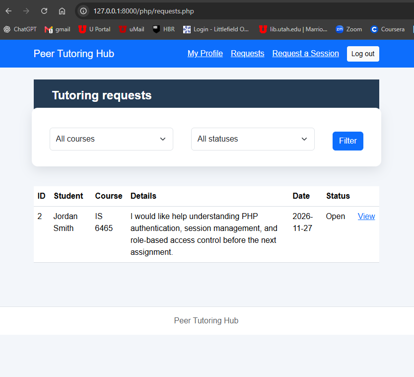

No application code or automated test files were modified to complete this test.

---

### 9.5 Skills Pack Reflection

The AI Skills Pack helped me better understand how the application's presentation, application, and data tiers work together to support authentication and authorization. The Application Builder explained the responsibilities of each layer, while the Traceability Auditor helped connect specific requirements to their implementation and associated test evidence. Verifying the AI responses against the actual source code demonstrated the importance of independently validating AI-generated explanations rather than assuming they are entirely accurate. The Test Harness Generator also identified a gap in automated testing related to session ID regeneration, which I was able to verify successfully through manual browser testing. Overall, the Skills Pack demonstrated how AI can support application development, documentation, and testing while still requiring human oversight and verification.

## Part 10: Inspect the Database

### 10.1 Database Access

From the lab7 project root, I opened the SQLite database using the following command:

```powershell
sqlite3 database/tutoring.db
```

I configured the SQLite output to display column headings and formatted columns using:

```sql
.headers on
.mode column
```

### 10.2 Database Relationship Query

I executed the instructor-provided SQL query:

```sql
SELECT
    u.user_id,
    u.full_name,
    u.email,
    u.role,
    u.status,
    s.student_id,
    s.student_name,
    s.student_email
FROM users AS u
LEFT JOIN students AS s
    ON u.user_id = s.user_id
ORDER BY u.user_id;
```

### 10.3 Query Results

The query executed successfully and returned the following output:

```text
user_id      full_name                email                role       status  student_id  student_name       student_email
-------  ------------------  ------------------------  -------------  ------  ----------  ------------  ------------------------
      1  Test Administrator  admin@example.com         Administrator  Active
      2  Jordan Smith        jordan.smith@example.com  Student        Active           2  Jordan Smith  jordan.smith@example.com
```

For readability, the results are also presented in the following table. Blank SQLite values are represented as NULL.

| user_id | full_name | email | role | status | student_id | student_name | student_email |
|---|---|---|---|---|---|---|---|
| 1 | Test Administrator | admin@example.com | Administrator | Active | NULL | NULL | NULL |
| 2 | Jordan Smith | jordan.smith@example.com | Student | Active | 2 | Jordan Smith | jordan.smith@example.com |

Both test accounts were returned successfully. The student account has a corresponding student record, while the administrator account does not.

### 10.4 Database Relationship Questions

#### 1. What does the LEFT JOIN do in this query?

The LEFT JOIN returns every record from the users table, regardless of whether a corresponding record exists in the students table. When a matching student record exists, the query includes the associated student information. When no matching record exists, the corresponding student fields contain NULL values.

This allows the application to retrieve all user accounts, including administrators, without excluding accounts that do not have student profiles. An INNER JOIN would exclude the administrator in this example because the administrator does not have a matching student record.

#### 2. How does the users table connect to the students table?

The users table connects to the students table through the user_id field. The user_id column in the users table is the primary key, while the user_id column in the students table is a foreign key referencing the associated user account.

The upgrade-to-user-management.sql script establishes this relationship and creates a unique index on students.user_id to prevent multiple student profiles from being associated with the same user account.

The query results confirm this relationship because Jordan Smith's account has a user_id of 2 and is associated with student_id 2. Although these two identifiers have the same numerical value in this example, they are separate identifiers. The relationship is established through students.user_id, not by matching user_id directly with student_id.

#### 3. Why does the application store account information separately from student profile information?

The application separates account information from student profile information because these records serve different purposes.

The users table manages authentication and authorization information, including email addresses, password hashes, account roles, account status, and account creation timestamps. The students table maintains student-specific information and provides the relationship needed to associate students with tutoring requests.

This separation improves database organization, supports different account roles, and maintains the existing tutoring request relationships established in Lab 6. It also allows authentication and account management to operate independently of student-specific functionality.

#### 4. Why may an administrator account not have a matching row in the students table?

An administrator account may not have a corresponding student record because administrators perform account management and administrative functions rather than participating in the student tutoring request workflow.

The application creates an administrator account in the users table without requiring a student profile. In contrast, registration of a Student account creates both a user account and an associated student record.

The query results demonstrate this distinction. The Test Administrator account exists in the users table with an active Administrator role, but its student_id, student_name, and student_email fields are NULL.

### 10.5 Database Inspection Conclusion

The database inspection confirmed that Lab 7 successfully extends the existing Lab 6 database structure to support user authentication, role-based authorization, and student-specific tutoring request ownership.

The LEFT JOIN query demonstrated that user accounts can exist independently of student records while still supporting relationships between authenticated student accounts and their tutoring requests.

The original Lab 6 student record belonging to Maria Lopez is not displayed in this query because the query begins with the users table and the legacy student record does not have an associated user account.

No database records were modified during this inspection.

I exited SQLite using:

```sql
.quit
```

Database Inspection Result: PASS
